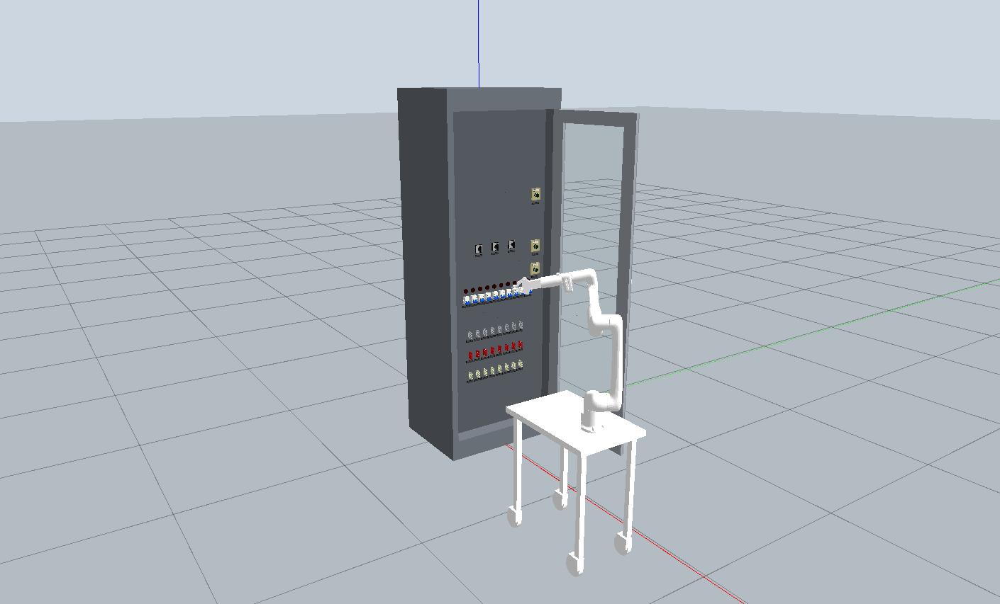
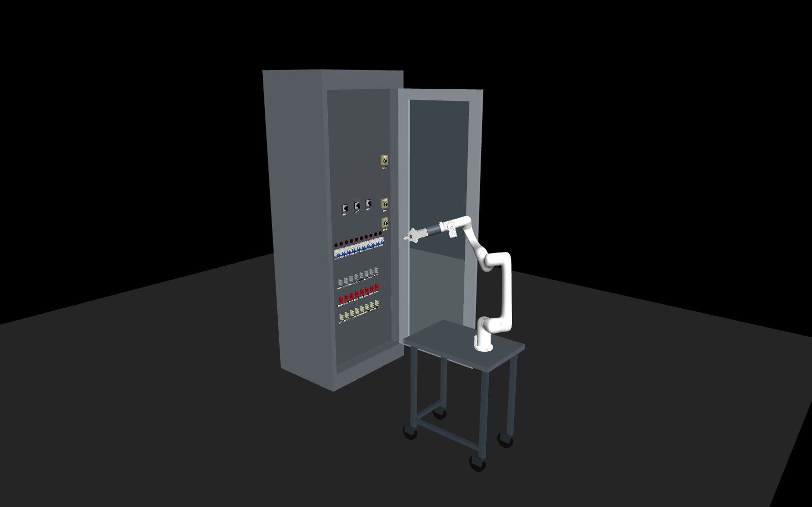
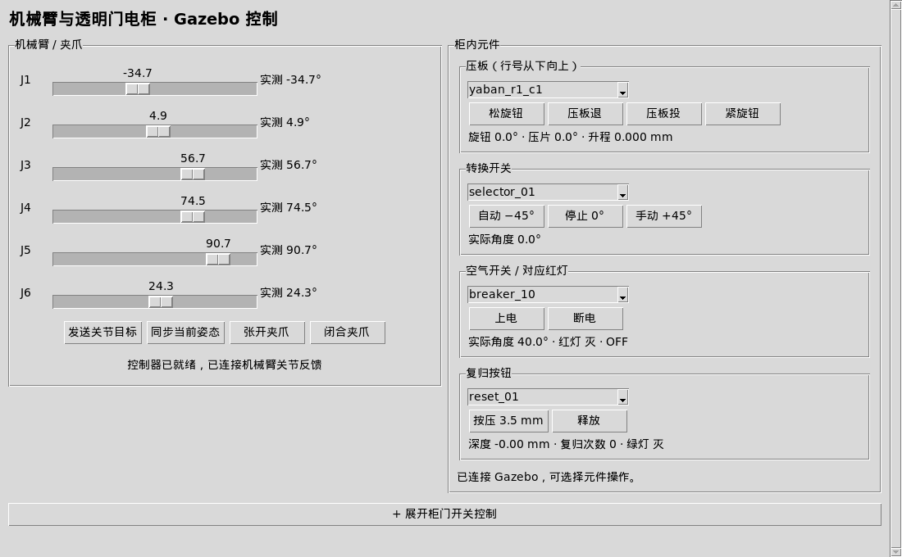

# Elec_cabinet_RML63

[English](README.md) | 简体中文

RML63II 六轴机械臂与电气柜基础仿真工作空间，提供 **Gazebo Classic 11 / ROS 2 Humble** 和 **MuJoCo** 两套运行入口，用于模型展示、关节控制与元件交互程序开发。

当前仅保留透明玻璃柜门版本。电柜及其元器件在外观、布局和结构上参照实际电柜建模，仅可作为视觉与结构参考。**当前设计的力反馈与实际操作的力反馈不一致，不具备真实力学反馈的参考价值。**项目的适用范围与限制见[已知问题与限制](#已知问题与限制)。

## 场景全景

Gazebo Classic 中的机械臂、工作台与透明柜门电柜完整场景：



MuJoCo 中的机械臂、工作台与透明柜门电柜完整场景：



## 目录

- [场景全景](#场景全景)
- [项目内容](#项目内容)
- [环境与依赖部署](#环境与依赖部署)
- [运行方法](#运行方法)
- [修改与重建模型](#修改与重建模型)
- [已知问题与限制](#已知问题与限制)

## 项目内容

| 模块 | 内容 |
| --- | --- |
| 机器人 | RML63II 六轴机械臂、EG2-4C2 夹爪、腕部 RGB-D 相机模型、工具法兰、指尖与工作台底座 |
| 电柜 | 柜体、透明玻璃柜门、铰链、门锁、按钮和把手 |
| 柜内元件 | 24 块压板、3 个转换开关、10 个空气开关、3 个复归按钮、10 个指示灯 |
| 标识 | 40 块元件编号铭牌；空气开关外壳的产品贴纸、商标及参数文字已移除，编号铭牌与其他元件文字保留 |
| Gazebo 控制 | 一个统一窗口控制机械臂、夹爪和柜内元件；开关门控制默认折叠，可点击展开 |
| MuJoCo 控制 | 完整机械臂与电柜场景、独立电柜操作、独立机械臂操作；关节目标、夹爪开合、局部笛卡尔微调与深度图预览 |
| 模型资源 | URDF / Xacro / MJCF、网格、材质、贴图、配置与模型生成脚本 |

两个仿真后端分别运行，没有实现 MuJoCo 与 ROS 2 的状态同步或控制桥接。项目不包含策略训练、数据集采集或真实机器人驱动。

```text
.
├── src/
│   ├── rml63ii_eg2_4c2_gazebo/   # 机械臂、夹爪、相机及控制
│   ├── electrical_cabinet_gazebo/ # 柜体、门锁与开关门状态机
│   ├── yaban_gazebo/            # 压板
│   ├── xuanniu_gazebo/          # 转换开关
│   ├── IO_gazebo/               # 空气开关，ROS 包名为 io_gazebo
│   ├── fugui_gazebo/            # 复归按钮
│   ├── total_cabinet_gazebo/    # 完整布局、透明门组合模型与控制界面
│   └── cabinet_sim_support/    # Gazebo 插件共用支持
├── tools/                      # 进程管理、Python 选择与模型重建工具
├── docs/                       # 场景与界面预览
├── README.md                   # 英文说明
├── README-zh.md                # 中文说明
├── requirements-mujoco.txt      # 整合入口的 Python 依赖
├── build.sh                    # 编译并安装 ROS 2 包
├── rebuild_models.sh           # 重新生成 URDF / MJCF
└── run_*.sh                    # 各仿真运行入口
```

## 环境与依赖部署

### 支持范围

当前脚本面向 **Linux**，主要验证环境为 **Ubuntu 22.04 x86_64 / WSL2 + WSLg**。

| 项目 | 已验证版本 / 要求 |
| --- | --- |
| Gazebo | Gazebo **Classic 11.10.2** |
| ROS 2 | Humble，系统 Python 3.10 |
| MuJoCo | **2.3.7**；使用根目录依赖清单 |
| MuJoCo Python | Python 3.10、3.11；验证环境为 3.11.16，另以新建 3.10 虚拟环境验证了无窗口入口 |
| 数值与图像库 | NumPy 1.26.4 已验证；Pillow 由根依赖清单安装 |
| 图形界面 | Tk、OpenGL / Mesa，以及可用的显示服务；Windows 主机使用 WSLg |
| 编译 | C/C++ 编译器；Gazebo 另需 CMake、colcon、Gazebo 开发库和 TBB |

Gazebo Classic 已于 2025 年 1 月结束官方支持。当前项目仍依赖 Classic 的插件接口，不能直接用新版 Gazebo Sim 替换。[官方说明](https://classic.gazebosim.org/)

仅运行 MuJoCo 可以跳过 Gazebo / ROS 2 部署。以下步骤需要联网和相应的软件源权限；本仓库目前没有一键安装器、容器镜像或完整离线运行环境，也未完成全新操作系统上的端到端安装验收。

### 1. 获取源码

需先安装 Git（Ubuntu 可执行 `sudo apt install git`），也可下载仓库 ZIP 并解压。

```bash
git clone https://github.com/Lancerman2001/Elec_cabinet_RML63.git robot_cabinet_ws
cd robot_cabinet_ws
```

后续命令均在仓库根目录执行。已有本地副本时直接进入对应目录即可。

### 2. 部署 MuJoCo

Ubuntu 22.04 的基础依赖：

```bash
sudo apt update
sudo apt install -y \
  git build-essential python3-venv python3-tk \
  libgl1 libegl1 libgl1-mesa-dri mesa-utils
```

创建项目独立环境并安装依赖：

```bash
/usr/bin/python3 -m venv .venv
.venv/bin/python -m pip install -r requirements-mujoco.txt
export MUJOCO_PYTHON="$PWD/.venv/bin/python"
```

验证环境与无窗口运行：

```bash
.venv/bin/python -c "import mujoco, numpy, tkinter; print(mujoco.__version__, numpy.__version__)"
./run_mujoco.sh --headless --seconds 1
```

说明：

- 整合入口以根目录 [requirements-mujoco.txt](requirements-mujoco.txt) 为准。不要递归安装所有子目录依赖；部分旧独立 Qt 工具使用不同版本的 MuJoCo / PyQt5。
- 不需要安装或复制 openpi 项目。启动器会优先使用 `MUJOCO_PYTHON`，其次查找项目 `.venv`；本机已有环境只是后备候选。
- 使用其他 Python 解释器时，该解释器必须能导入 `tkinter`。Ubuntu 的 `python3-tk` 只对应其系统 Python。
- MuJoCo 2.3.7 的部分兼容操作会首次调用 `cc` 编译仓库中的辅助 C 代码，缓存到 `~/.cache/arm_sim`，因此保留 `build-essential`。
- `--headless` 进行纯物理步进，不创建控制面板或查看器；调用相机渲染接口时仍需可用的图形后端。

### 3. 部署 Gazebo / ROS 2

先按 [ROS 2 Humble 官方安装说明](https://docs.ros.org/en/humble/Installation/Ubuntu-Install-Debs.html) 配置 Ubuntu 22.04 的 ROS 2 软件源。以下命令以 ROS 2 软件源及 Ubuntu `universe` 已配置为前提：

```bash
sudo apt update
sudo apt install -y \
  build-essential cmake pkg-config libtbb-dev \
  python3-colcon-common-extensions python3-tk \
  fontconfig fonts-droid-fallback ripgrep \
  gazebo libgazebo-dev \
  ros-humble-ros-base ros-humble-rosidl-default-generators \
  ros-humble-gazebo-dev ros-humble-gazebo-ros-pkgs \
  ros-humble-gazebo-ros2-control ros-humble-controller-manager \
  ros-humble-joint-state-broadcaster ros-humble-joint-trajectory-controller \
  ros-humble-control-msgs ros-humble-robot-state-publisher \
  ros-humble-tf2-ros ros-humble-xacro
```

可选目录 `.deps/root/` 仅包含开发机使用的部分 Linux x86_64 / Humble / Python 3.10 运行依赖，不包含 ROS 或 Gazebo 本体，不能作为跨系统、跨架构的通用安装包。存在时，`ros_env.sh` 会优先加载它。选择上述系统包路线时，应在系统依赖安装完成后，将已有 `.deps` 移到仓库外保留备份，再构建；安装 apt 包不会自动绕过该补充目录。

编译并启动：

```bash
./build.sh
./run_gazebo.sh
```

脚本使用 `/opt/ros/humble`、`/usr/share/gazebo/setup.sh` 和系统 `/usr/bin/python3`。ROS 与 MuJoCo 使用不同 Python 环境，不需要在 MuJoCo 虚拟环境中安装 ROS Python 包。

## 运行方法

### MuJoCo

```bash
# 完整机械臂与透明门电柜：查看器 + 基础控制面板
./run_mujoco.sh

# 独立电柜：直接选择元件并操作，包含门控
./run_cabinet_mujoco.sh

# 独立机械臂
./run_arm_mujoco.sh

# 完整场景：D435 深度图预览
./run_mujoco.sh --view d435_depth

# 独立机械臂：D435 深度图预览
./run_arm_mujoco.sh --camera d435_depth

# 完整场景：固定的全局彩色视角
./run_mujoco.sh --view global_default

# 完整场景，无窗口推进 5 秒仿真时间并输出状态
./run_mujoco.sh --headless --seconds 5
```

完整场景主要通过机械臂位置目标与被动元件机构交互。独立电柜入口提供直接操作演示，门和压板包含运动学控制，两者不能作为等价的机器人接触操作实验。

相机入口为 RealSense 的 `d435_rgb`、`d435_depth`，以及完整场景的固定彩色视角 `global_default`。全局相机仅保留这一普通视角，不设置独立深度相机。

在控制面板或原生查看器中选择 `d435_depth`，会打开独立的灰度深度预览。原生三维查看器保留 RGB 显示，用于场景交互。深度预览取自深度缓冲，显示范围为 0.1～5 米，近处亮、远处暗，远端背景与无效值为黑色，不是将 RGB 图转为灰度。预览仍需要图形渲染环境，`--no-viewer` 不会取消这一要求；`--headless` 不创建预览。

Python 接口 `env.render(camera="d435_depth")` 默认返回 `(H, W)`、`float32` 的米制深度，表示沿相机光轴的距离；`env.render(camera="global_default")` 返回彩色图。`depth=True` 可显式请求深度，`depth=False` 可显式请求 RGB。原始深度数组不受预览显示范围或灰度归一化影响。

深度渲染回归检查（需要可用的 OpenGL 后端）：

```bash
tools/mujoco_python.sh tools/check_mujoco_depth.py
```

### Gazebo

```bash
# 完整透明门场景 + 一个统一控制窗口
./run_gazebo.sh

# 无客户端窗口、无控制面板
./run_gazebo.sh gui:=false

# 仅控制窗口，不打开 Gazebo 三维客户端
./run_gazebo.sh gui:=false control_gui:=true

# 只加载电柜 / 只加载机械臂
./run_gazebo.sh with_robot:=false
./run_gazebo.sh with_cabinet:=false

# 启动时关门，玻璃仍保持透明
./run_gazebo.sh initial_pose:=closed
```

统一窗口中，机械臂与元件控制并排显示；柜门控制默认收起，点击“展开柜门开关控制”即可展开。展开或收起只改变界面布局，不会触发门动作，也不会重复创建控制程序。



`gui:=false` 只关闭客户端界面，相机传感器仍会尝试渲染。无显示服务的服务器可能需要另外配置虚拟显示或适用的 OpenGL 环境。

### 操作约定

- 压板：先松旋钮至少 180°，等实测到位后退出；先投入并等待到位，再紧旋钮。过早执行下一步可能被互锁拒绝。
- 柜门：正常关门依次执行“门回转 → 门把手回转 → 把手回扣”；正常开门先按按钮弹出把手，再转把手开门。“强制复位”属于调试操作。
- 单位：界面关节角以度显示，Python / 轨迹接口以弧度表示，位置以米表示。
- 夹爪：MuJoCo 七维动作最后一维为闭合度，`0=全开，1=全闭`；Gazebo `gripper_joint1` 使用物理角度，约 `0 rad=闭合，0.82 rad=张开`，两者不能直接混用。
- 工作台默认锁定；Gazebo 的 `table_locked:=false` 为被动脚轮模式，没有实现移动底盘驱动。
- 按启动终端的 `Ctrl+C` 退出，等待进程清理完成后再重启。

WSL 默认使用软件渲染。需要显式指定时：

```bash
ARM_GAZEBO_RENDERER=software ./run_gazebo.sh
ARM_MUJOCO_RENDERER=software ./run_mujoco.sh
```

可选值为 `auto`、`software`、`hardware`；实际帧率取决于主机和图形驱动。

### ROS 通信与常见检查

```bash
source ros_env.sh
ros2 topic list --no-daemon
ros2 service call /arm/controller_manager/list_controllers \
  controller_manager_msgs/srv/ListControllers '{}'
```

默认 `ROS_DOMAIN_ID=64`，Gazebo master 为 `http://127.0.0.1:11355`。同机其他 ROS 控制终端需先执行 `source ros_env.sh`，使用相同 domain 和本机通信设置；可通过 `ROS_DOMAIN_ID` 和 `ARM_GAZEBO_MASTER_URI` 更换 domain 或本机 master 端口。

机械臂轨迹入口为 `/arm/arm_joint_controller/follow_joint_trajectory` 与 `/arm/gripper_controller/follow_joint_trajectory`；关节反馈为 `/arm/joint_states`，整柜反馈为 `/total_cabinet/joint_states`。

Gazebo D435 的图像与点云话题：

| 话题 | 数据 |
| --- | --- |
| `/camera/color/image_raw` | `rgb8` 彩色图，640×480 |
| `/camera/depth/image_rect_raw` | `32FC1` 米制深度图，640×480；超量程背景可能为 `Inf` |
| `/camera/depth/points` | XYZ + RGB 点云；按 RGB 着色时仍会显示物体颜色 |

上述编码已通过实际订阅消息核实。Gazebo 三维视窗中的相机视角仍是场景渲染；查看深度图应使用图像工具选择 `/camera/depth/image_rect_raw`。可选安装并启动：

```bash
sudo apt install ros-humble-rqt-image-view
source ros_env.sh
ros2 run rqt_image_view rqt_image_view
```

### 网络与隐私范围

本项目用于本机仿真，不提供网站或公网控制服务。ROS 启动环境强制使用 `ROS_LOCALHOST_ONLY=1`；Gazebo 使用回环通信地址与仅允许 `127.0.0.1` 的入站来源白名单，同时移除继承的 `GAZEBO_HOSTNAME`。独立转换开关工具的无认证 TCP 演示服务也只允许绑定回环地址，三个整合 MuJoCo 入口不启动该服务。

Gazebo Classic 底层仍可能以 `0.0.0.0` 监听 master 及动态 TCP 端口；回环 URI 本身不能限制监听地址，来源白名单也不能等同于防火墙、TLS 或身份认证。在带公网接口的主机上运行时，仍需由主机防火墙或隔离网络阻止外部入站连接，不应为这些仿真端口配置公网映射。`ROS_DOMAIN_ID` 仅用于区分通信域，不是安全认证。

仓库保留运行模型所需的尺寸、惯量、限位、摩擦与相机内参等参数，不包含真机连接凭据或设备序列号。生成模型使用相对来源路径，不含开发机个人目录。现有第三方来源署名保留。

## 修改与重建模型

使用仓库内已有模型时，无需执行本节。模型重建会同时调用 ROS 的 `xacro` 和 MuJoCo，因此需要先完成两套依赖部署。

```bash
# 首次建立包索引，或在修改包内配置后先同步配置
./build.sh

# 更新 src 下的 URDF / MJCF
./rebuild_models.sh

# 更新 Gazebo 从 install 读取的模型和脚本
./build.sh
```

MuJoCo 默认直接读取 `src/` 下的模型；Gazebo 读取 `install/` 下的资源，因此修改后需要重新构建。两者都只生成透明门场景。

主要模型入口：

| 用途 | 路径 |
| --- | --- |
| Gazebo 完整透明门电柜 | `src/total_cabinet_gazebo/urdf/total_cabinet_glass.ros2.urdf` |
| MuJoCo 完整机械臂与电柜 | `src/total_cabinet_gazebo/mujoco/robot_cabinet_scene_glass_door.xml` |
| MuJoCo 独立电柜 | `src/total_cabinet_gazebo/mujoco/total_cabinet_glass_door.xml` |
| MuJoCo 独立机械臂 | `src/rml63ii_eg2_4c2_gazebo/model_mjcf/scene.xml` |

默认复用预生成铭牌贴图，不需要 Windows 字体文件。修改铭牌文字或尺寸时，应提供对应的 SimSun 字体：

```bash
CABINET_REUSE_NAMEPLATES=0 \
CABINET_NAMEPLATE_FONT=/absolute/path/to/simsun.ttc \
./rebuild_models.sh
```

## 已知问题与限制

### 适用范围与力反馈边界

电柜及其元器件用于展示与实物相似的外观、布局和结构，仅适合作为视觉与结构参考。当前设计的力反馈与真实操作的力反馈不一致；仿真中的接触力、力矩、弹簧和摩擦响应均不具备真实力学反馈的参考价值。

**这些力学输出不适用于真实受力估计、操作力阈值设定、力控验证或真实设备安全评估，也不能据此推断仿真到实机的可迁移性。**界面动作完成、元件状态切换或接触数值稳定，只代表相应程序逻辑或数值工况下的表现。

### 控制与接触稳定性

| 项目 | 当前实现与限制 |
| --- | --- |
| 机械臂控制 | Gazebo 使用关节位置轨迹控制；MuJoCo 使用位置参考、等效 PD 执行器、参考限速和重力前馈。当前运行入口未实现机械臂末端闭环力控或专用的笛卡尔阻抗 / 导纳控制器。 |
| 接触后的响应 | 接触力未反馈到机械臂参考生成中，未实现按末端力目标调节、超力自动退让或基于末端力反馈的接触建立与保持策略。持续给定进入碰撞体的位置目标，可能产生较大的仿真接触载荷或跟踪偏差。 |
| 触碰元件时反复颤抖 | 已有用户报告，列为待定位问题。尚未完成不同元件、姿态、速度和两套后端下的系统性复现、根因定位与稳定性验证，不能认定已解决。 |
| MuJoCo 笛卡尔微调 | 采用局部数值 IK，有有限精度与收敛条件；不是避障运动规划。小于位置 / 姿态容差的增量可能被判为已到达，不保证任意微小命令均产生可分辨运动。 |
| 场景摆放 | 小车与柜门摆放属于设置操作；端点穿透检查不能替代沿路径的碰撞检查或运动规划。 |

对颤抖问题的核实范围：已检查实际启动入口和控制链，并在一组未修改模型及控制参数的 MuJoCo 静态接触工况中保持目标约 3 秒仿真时间。该工况出现小幅漂移与位置跟踪误差，未复现持续大幅往复振荡。这只记录了该工况的数值表现，不覆盖其他元件、姿态或 Gazebo 工况，不能证明接触普遍稳定，也不能证明力反馈具有真实性或实际参考价值。

位置目标与碰撞 / 机构约束之间的相互作用是需要排查的因素；时间步、接触求解、惯性近似、关节限位及从动约束也可能影响结果。目前没有足够证据将用户观察到的颤抖归结为某个确定原因，例如单一 PID 参数或力矩饱和。

控制实现可查阅 [Gazebo 控制器配置](src/rml63ii_eg2_4c2_gazebo/config/ros2_controllers.yaml)、[MuJoCo 机械臂控制](src/rml63ii_eg2_4c2_gazebo/mujoco/environment.py)和[元件接触观测](src/total_cabinet_gazebo/mujoco/interaction_backend.py)。

### 传感与反馈

当前支持相机、关节状态和局部接触观测，主要用于可视化与程序状态检查，不能据此还原真实操作的力反馈：

- **已有信息**：Gazebo 的腕部 RGB-D、关节反馈和柜门按钮接触信息；MuJoCo 的相机渲染、元件关节 / 按钮 touch 信息，以及引擎接触力统计。
- **未配置能力**：机械臂腕部六维力 / 力矩传感器、指尖触觉阵列，以及使用这些测量量的机械臂力反馈控制链。
- **力学输出的边界**：引擎计算的接触力、关节 `effort` 接口和接触标志只反映仿真内部状态，不具备实机受力的参考价值，也不等同于真实力传感器测量或闭环力控制。
- **相机简化**：当前 D435 对应理想化 RGB-D 渲染，深度图为引擎计算的几何深度，未模拟真实 D435 的红外双目成像过程，也未完整模拟噪声、畸变、标定误差和时延特性；配置的标称分辨率 / 频率不保证实际运行帧率。

### 机构模型与验证边界

- Gazebo 的柜门和部分压板动作采用运动学插件设置位置；独立 MuJoCo 电柜入口的门 / 压板也包含规定运动。界面按钮成功不等同于机械臂依靠接触力完成了操作。
- 默认 MuJoCo 完整场景使用被动机构力、约束和机器人接触，以支持演示中的运动与交互逻辑；这些参数及其响应不应作为实际电柜或元器件力学特性的参考。
- 两个后端的控制与接触处理不同，不保证相同指令得到相同的位姿、载荷或操作结果。
- 目前验证主要覆盖场景加载、界面、关节轨迹、元件命令与开关门协议。这些检查不构成真实受力或操作手感的验证，也未覆盖机器人接触操作的全面稳定性和跨平台性能。
- 场景较复杂，软件渲染时可能显著慢于实时；Gazebo Classic 已停止官方支持，长期维护还需考虑依赖可用性及迁移工作。

遇到接触抖动时，建议在 GitHub Issue 中提供仿真后端和版本、启动命令、元件编号、机械臂起始姿态及目标、触碰过程视频和相关日志，以便定位具体复现条件。
