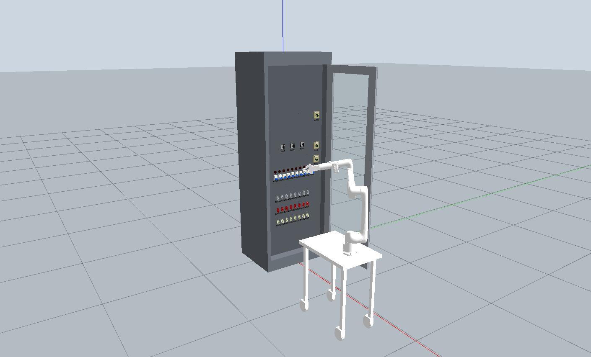
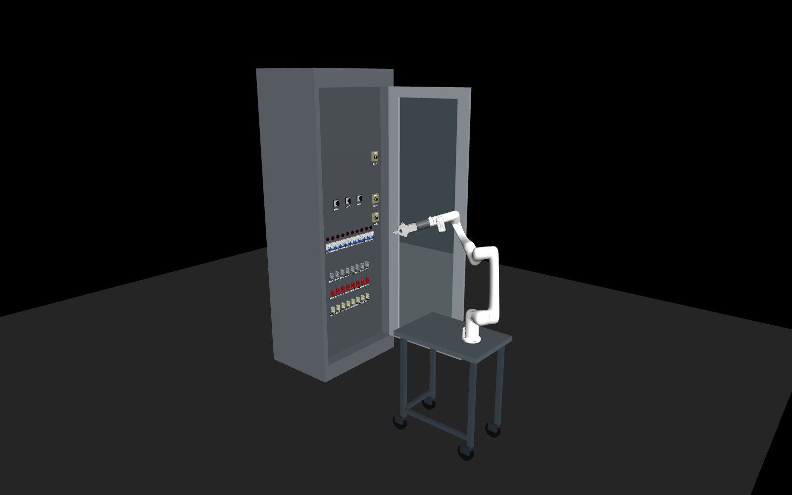
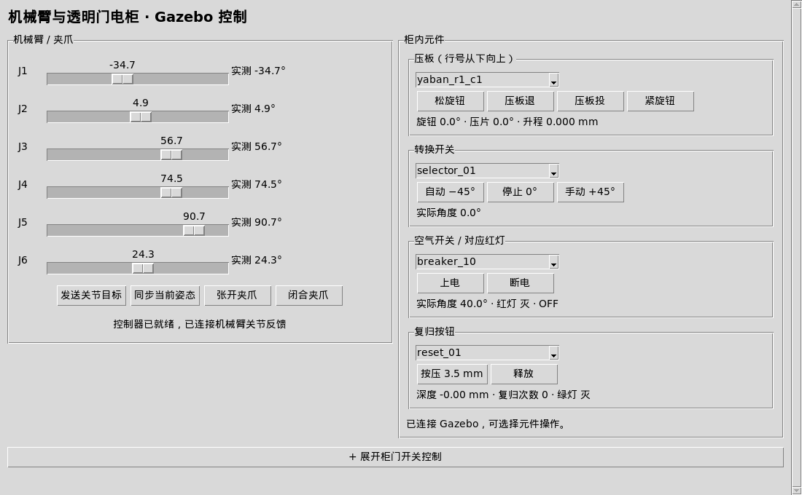

# Elec_cabinet_RML63

English | [简体中文](README-zh.md)

A basic simulation workspace for the RML63II six-axis arm and an electrical cabinet, with **Gazebo Classic 11 / ROS 2 Humble** and **MuJoCo** entry points for model visualization, joint control, and component interaction demonstrations.

Only the transparent glass-door cabinet is included. The cabinet and its components provide a visual and structural analogy to a real cabinet. Their intended use is appearance, layout, and structural reference. **The simulated force feedback does not match real operation and has no value as a reference for real operating forces or mechanical behavior.** See [Known issues and limitations](#known-issues-and-limitations) before using the models.

## Scene overviews

Gazebo Classic: the complete arm and cabinet scene with the transparent door.



MuJoCo: the complete arm and cabinet scene with the transparent door.



## Contents

- [Scene overviews](#scene-overviews)
- [Included modules](#included-modules)
- [Environment and dependencies](#environment-and-dependencies)
- [Running the simulations](#running-the-simulations)
- [Editing and regenerating models](#editing-and-regenerating-models)
- [Known issues and limitations](#known-issues-and-limitations)

## Included modules

| Module | Contents |
| --- | --- |
| Robot | RML63II six-axis arm, EG2-4C2 gripper, wrist RGB-D camera model, tool flange, fingertips, and mobile table |
| Cabinet | Enclosure, transparent glass door, hinges, latch, button, and handle |
| Cabinet components | 24 pressure plates, 3 selector switches, 10 circuit breakers, 3 reset buttons, and 10 indicator lamps |
| Labels | 40 component identification nameplates; product decals, branding, and specification text have been removed from the breaker housings, while component identifiers and text on other components remain |
| Gazebo controls | One unified window for the arm, gripper, and cabinet components; door controls are collapsed by default and can be expanded |
| MuJoCo controls | Complete arm/cabinet scene, standalone cabinet demo, standalone arm demo, joint targets, gripper opening/closing, local Cartesian jogging, and a depth preview |
| Model resources | URDF / Xacro / MJCF, meshes, materials, textures, configuration, and generation scripts |

The two simulation backends run separately. There is no state synchronization or control bridge between MuJoCo and ROS 2. Policy training, dataset collection, and real robot drivers are outside this workspace.

```text
.
├── src/
│   ├── rml63ii_eg2_4c2_gazebo/   # Arm, gripper, camera, and controls
│   ├── electrical_cabinet_gazebo/ # Enclosure, latch, and door state machine
│   ├── yaban_gazebo/             # Pressure plates
│   ├── xuanniu_gazebo/           # Selector switches
│   ├── IO_gazebo/                # Circuit breakers; ROS package: io_gazebo
│   ├── fugui_gazebo/             # Reset buttons
│   ├── total_cabinet_gazebo/     # Complete layout, glass-door models, and UI
│   └── cabinet_sim_support/     # Shared Gazebo plugin support
├── tools/                       # Process management, Python selection, model generation
├── docs/                        # Scene and UI previews
├── README.md                    # English documentation
├── README-zh.md                 # Chinese documentation
├── requirements-mujoco.txt       # Python dependencies for the integrated entry points
├── build.sh                     # Build and install ROS 2 packages
├── rebuild_models.sh            # Regenerate URDF / MJCF
└── run_*.sh                     # Simulation entry points
```

## Environment and dependencies

### Supported environment

The scripts target **Linux**. The main tested environment is **Ubuntu 22.04 x86_64 / WSL2 with WSLg**.

| Item | Tested version / requirement |
| --- | --- |
| Gazebo | Gazebo **Classic 11.10.2** |
| ROS 2 | Humble, using system Python 3.10 |
| MuJoCo | **2.3.7**, using the root dependency file |
| MuJoCo Python | Python 3.10 and 3.11; tested with 3.11.16, plus headless entry points in a fresh Python 3.10 virtual environment |
| Numerical and image libraries | NumPy 1.26.4 tested; Pillow installed from the root dependency file |
| GUI | Tk, OpenGL / Mesa, and a working display service; use WSLg on a Windows host |
| Build tools | C/C++ compiler; Gazebo also requires CMake, colcon, Gazebo development libraries, and TBB |

Gazebo Classic reached end of official support in January 2025. This project depends on Classic plugin interfaces and cannot directly substitute the newer Gazebo Sim. [Official notice](https://classic.gazebosim.org/)

For MuJoCo only, skip the Gazebo / ROS 2 installation. The following steps require network access and access to the relevant package repositories. There is currently no one-click installer, container image, or complete offline environment. Installation on a freshly installed operating system has not been validated end to end.

### 1. Get the source

Install Git first (`sudo apt install git` on Ubuntu), or download and extract the repository ZIP.

```bash
git clone https://github.com/Lancerman2001/Elec_cabinet_RML63.git robot_cabinet_ws
cd robot_cabinet_ws
```

Run the remaining commands from the repository root. If a local copy already exists, enter that directory instead.

### 2. Install MuJoCo dependencies

System dependencies for Ubuntu 22.04:

```bash
sudo apt update
sudo apt install -y \
  git build-essential python3-venv python3-tk \
  libgl1 libegl1 libgl1-mesa-dri mesa-utils
```

Create a project environment and install the Python dependencies:

```bash
/usr/bin/python3 -m venv .venv
.venv/bin/python -m pip install -r requirements-mujoco.txt
export MUJOCO_PYTHON="$PWD/.venv/bin/python"
```

Check the environment and run without a viewer:

```bash
.venv/bin/python -c "import mujoco, numpy, tkinter; print(mujoco.__version__, numpy.__version__)"
./run_mujoco.sh --headless --seconds 1
```

Notes:

- Use the root [requirements-mujoco.txt](requirements-mujoco.txt) for the integrated entry points. Do not recursively install every dependency file: some older standalone Qt tools require different MuJoCo / PyQt5 versions.
- The openpi project is not required. The launcher first checks `MUJOCO_PYTHON`, then the project `.venv`; existing development environments are only fallback candidates.
- An alternative Python interpreter must support `import tkinter`. Ubuntu's `python3-tk` package corresponds to its system Python.
- Some MuJoCo 2.3.7 compatibility operations compile auxiliary C code with `cc` on first use and cache it in `~/.cache/arm_sim`; keep `build-essential` installed.
- `--headless` advances physics without a control panel or viewer. Calling the camera rendering API still requires a working graphics backend.

### 3. Install Gazebo / ROS 2 dependencies

Configure the ROS 2 package repository for Ubuntu 22.04 using the [official ROS 2 Humble instructions](https://docs.ros.org/en/humble/Installation/Ubuntu-Install-Debs.html). These commands assume that both the ROS 2 repository and Ubuntu `universe` are enabled:

```bash
sudo apt update
sudo apt install -y \
  build-essential cmake pkg-config libtbb-dev \
  python3-colcon-common-extensions python3-tk \
  fontconfig fonts-droid-fallback ripgrep \
  gazebo libgazebo-dev \
  ros-humble-ros-base ros-humble-rosidl-default-generators \
  ros-humble-gazebo-dev ros-humble-gazebo-ros-pkgs \
  ros-humble-gazebo-ros2-control ros-humble-controller-manager \
  ros-humble-joint-state-broadcaster ros-humble-joint-trajectory-controller \
  ros-humble-control-msgs ros-humble-robot-state-publisher \
  ros-humble-tf2-ros ros-humble-xacro
```

The optional `.deps/root/` directory contains only a subset of development-machine dependencies for Linux x86_64 / Humble / Python 3.10. It does not include ROS or Gazebo itself and is not a portable installation package. If present, `ros_env.sh` loads it first. When using the system packages above, move an existing `.deps` directory outside the repository as a backup after installing those packages, then build. Installing apt packages alone does not bypass that directory.

Build and launch:

```bash
./build.sh
./run_gazebo.sh
```

The scripts use `/opt/ros/humble`, `/usr/share/gazebo/setup.sh`, and system `/usr/bin/python3`. ROS and MuJoCo use separate Python environments; ROS Python packages do not need to be installed into the MuJoCo virtual environment.

## Running the simulations

### MuJoCo

```bash
# Complete arm and glass-door cabinet: viewer and basic control panel
./run_mujoco.sh

# Standalone cabinet: direct component operations, including door controls
./run_cabinet_mujoco.sh

# Standalone arm
./run_arm_mujoco.sh

# Complete scene: D435 depth preview
./run_mujoco.sh --view d435_depth

# Standalone arm: D435 depth preview
./run_arm_mujoco.sh --camera d435_depth

# Complete scene: fixed global color view
./run_mujoco.sh --view global_default

# Complete scene: advance 5 simulated seconds without windows and print state
./run_mujoco.sh --headless --seconds 5
```

The complete scene uses arm position targets and passive component mechanisms for interaction demonstrations. The standalone cabinet demo includes prescribed motion for the door and pressure plates. These modes are not equivalent robot contact-manipulation experiments, and neither provides physically representative cabinet force feedback.

Camera choices are the RealSense `d435_rgb` and `d435_depth`, plus the complete scene's fixed color view `global_default`. The global camera has no separate depth-camera entry.

Selecting `d435_depth` in the control panel or native viewer opens a separate grayscale depth preview. The native 3D viewer keeps its RGB scene display for interaction. The preview uses the depth buffer with a fixed display range of 0.1–5 m: near surfaces are bright, distant surfaces are dark, and far background / invalid values are black. This is not a grayscale conversion of RGB. A graphics environment is still required with `--no-viewer`; `--headless` does not create a preview.

The Python API `env.render(camera="d435_depth")` returns an `(H, W)` `float32` depth array in meters along the camera's optical axis by default. `env.render(camera="global_default")` returns a color image. Use `depth=True` or `depth=False` to request depth or RGB explicitly. Raw depth values are unaffected by the preview range or grayscale mapping.

Depth rendering regression check, requiring a working OpenGL backend:

```bash
tools/mujoco_python.sh tools/check_mujoco_depth.py
```

### Gazebo

```bash
# Complete glass-door scene and unified control window
./run_gazebo.sh

# No 3D client or control panel
./run_gazebo.sh gui:=false

# Control panel without the Gazebo 3D client
./run_gazebo.sh gui:=false control_gui:=true

# Cabinet only / arm only
./run_gazebo.sh with_robot:=false
./run_gazebo.sh with_cabinet:=false

# Start with the transparent glass door closed
./run_gazebo.sh initial_pose:=closed
```

The unified window displays arm and component controls side by side. Door controls are initially collapsed; click “展开柜门开关控制” to expand them. Expanding or collapsing the section only changes the layout: it does not move the door or create another control process.



`gui:=false` disables the 3D client, but camera sensors still attempt to render. A server without a display service may need a virtual display or a suitable OpenGL setup.

### Operation conventions

- Pressure plates: loosen the knob by at least 180° and wait for the measured position before withdrawing the plate. Insert the plate and wait before tightening the knob. Commands sent too early may be rejected by the interlock.
- Door: close in the order door rotation → handle rotation → handle retraction. To open, press the button to release the handle, then turn the handle and open the door. Force reset is a debugging operation.
- Units: the UI displays joint angles in degrees; Python and trajectory interfaces use radians, and positions use meters.
- Gripper: the last element of the seven-value MuJoCo action is closedness (`0 = fully open`, `1 = fully closed`). Gazebo `gripper_joint1` uses a physical angle, approximately `0 rad = closed`, `0.82 rad = open`. Do not interchange these values.
- The table is locked by default. Gazebo `table_locked:=false` enables passive casters; no mobile-base drive is implemented.
- Exit with `Ctrl+C` in the launch terminal and wait for process cleanup before restarting.

WSL uses software rendering by default. To select it explicitly:

```bash
ARM_GAZEBO_RENDERER=software ./run_gazebo.sh
ARM_MUJOCO_RENDERER=software ./run_mujoco.sh
```

Available values are `auto`, `software`, and `hardware`. Actual frame rate depends on the host and graphics driver.

### ROS communication and checks

```bash
source ros_env.sh
ros2 topic list --no-daemon
ros2 service call /arm/controller_manager/list_controllers \
  controller_manager_msgs/srv/ListControllers '{}'
```

The default `ROS_DOMAIN_ID` is `64`, and the Gazebo master is `http://127.0.0.1:11355`. Other ROS terminals on the same machine should first run `source ros_env.sh` to use the same domain and local communication settings. Override `ROS_DOMAIN_ID` or `ARM_GAZEBO_MASTER_URI` to change the domain or local master port.

Arm trajectory actions are `/arm/arm_joint_controller/follow_joint_trajectory` and `/arm/gripper_controller/follow_joint_trajectory`. Joint feedback topics are `/arm/joint_states` and `/total_cabinet/joint_states`.

Gazebo D435 image and point-cloud topics:

| Topic | Data |
| --- | --- |
| `/camera/color/image_raw` | `rgb8` color image, 640×480 |
| `/camera/depth/image_rect_raw` | `32FC1` metric depth, 640×480; out-of-range background may be `Inf` |
| `/camera/depth/points` | XYZ + RGB point cloud; RGB coloring retains object colors |

These encodings have been checked by subscribing to actual messages. A camera view in the Gazebo 3D window is a scene rendering. To view depth, select `/camera/depth/image_rect_raw` in an image viewer. Optional viewer installation and launch:

```bash
sudo apt install ros-humble-rqt-image-view
source ros_env.sh
ros2 run rqt_image_view rqt_image_view
```

### Network and privacy scope

This is a local simulation project, not a website or public control service. The ROS environment enforces `ROS_LOCALHOST_ONLY=1`. Gazebo uses loopback addresses and an inbound source allowlist containing only `127.0.0.1`, and inherited `GAZEBO_HOSTNAME` settings are removed. The unauthenticated TCP demo in the standalone selector tool also only binds to loopback; the three integrated MuJoCo entry points do not start that service.

Gazebo Classic may still listen on `0.0.0.0` for its master and dynamic TCP ports. A loopback URI does not constrain the listening address, and a source allowlist is not a substitute for a firewall, TLS, or authentication. On a host with a public network interface, use a host firewall or isolated network to block external inbound connections. Do not forward these simulation ports to the public internet. `ROS_DOMAIN_ID` separates communication domains; it is not authentication.

The repository retains geometry, inertia, limits, friction, and camera intrinsics needed by the simulation, but contains no real-device connection credentials or device serial numbers. Generated models use relative source paths. Existing third-party attribution is preserved.

## Editing and regenerating models

Skip this section when using the included models. Regeneration invokes both ROS `xacro` and MuJoCo, so install both sets of dependencies first.

```bash
# Establish the package index, or synchronize edited package configuration
./build.sh

# Regenerate URDF / MJCF under src
./rebuild_models.sh

# Refresh the models and scripts read by Gazebo from install
./build.sh
```

MuJoCo reads models directly from `src/` by default. Gazebo reads installed resources, so rebuild after editing them. Both generators produce only the transparent-door scene.

Main model entry points:

| Purpose | Path |
| --- | --- |
| Gazebo complete glass-door cabinet | `src/total_cabinet_gazebo/urdf/total_cabinet_glass.ros2.urdf` |
| MuJoCo complete arm and cabinet | `src/total_cabinet_gazebo/mujoco/robot_cabinet_scene_glass_door.xml` |
| MuJoCo standalone cabinet | `src/total_cabinet_gazebo/mujoco/total_cabinet_glass_door.xml` |
| MuJoCo standalone arm | `src/rml63ii_eg2_4c2_gazebo/model_mjcf/scene.xml` |

Pre-generated nameplate textures are reused by default; Windows font files are not needed for normal use. To change nameplate text or dimensions, provide a corresponding SimSun font:

```bash
CABINET_REUSE_NAMEPLATES=0 \
CABINET_NAMEPLATE_FONT=/absolute/path/to/simsun.ttc \
./rebuild_models.sh
```

## Known issues and limitations

### Visual and structural reference only

The complete cabinet and its components are visually and structurally analogous to real equipment. They can be used as a reference for appearance, layout, and structure. **The designed force feedback differs from actual cabinet operation and is not a reference for real mechanical behavior.** Simulated contact forces, torques, operating resistance, springs, and friction must not be used to estimate real operating forces, select force thresholds, validate force-control methods, assess operational safety, or support transfer to real equipment.

This limitation applies even when a component moves or a task completes in the simulation. Successful UI commands, plausible-looking motion, or numerically reported contact forces do not establish physical validity.

### Control and contact stability

| Item | Current implementation and limitation |
| --- | --- |
| Arm control | Gazebo uses joint-position trajectories. MuJoCo uses position references, equivalent PD actuators, reference-rate limits, and gravity feedforward. The entry points do not implement end-effector closed-loop force control or a dedicated Cartesian impedance / admittance controller. |
| Contact response | Contact force is not fed back into arm reference generation. There is no end-effector force-target regulation, automatic retreat under excessive force, or force-feedback contact acquisition and holding strategy. Targets inside collision geometry may produce large simulated loads or tracking errors; those loads are not estimates of real operating forces. |
| Repeated shaking on contact | Reported by the user and remains unresolved. Systematic reproduction, root-cause analysis, and stability validation across components, poses, speeds, and both backends have not been completed. |
| MuJoCo Cartesian jogging | Local numerical IK has finite tolerances and convergence conditions; it is not collision-free motion planning. Increments below those tolerances may be considered reached without discernible motion. |
| Scene placement | Setting the table or door pose is a setup operation. An endpoint penetration check does not replace collision checking along a path or motion planning. |

The contact investigation covered the actual control paths and one MuJoCo static-contact case without changing model or control parameters: the arm approached the upper breaker housing with a position reference, then held the target for about 3 simulated seconds. Small drift and tracking error were observed, without sustained large back-and-forth oscillation in that case. This did not cover edge sliding, other poses, moving contact, or Gazebo. It establishes neither general contact stability nor correspondence with real operating forces.

Position targets interacting with collision or mechanism constraints are among the factors to investigate. Timestep, contact solving, approximate inertia, joint limits, and mimic constraints may also affect behavior. There is insufficient evidence to attribute the reported shaking to a single PID parameter or torque saturation.

Implementation references: [Gazebo controller configuration](src/rml63ii_eg2_4c2_gazebo/config/ros2_controllers.yaml), [MuJoCo arm control](src/rml63ii_eg2_4c2_gazebo/mujoco/environment.py), and [component contact observations](src/total_cabinet_gazebo/mujoco/interaction_backend.py).

### Sensors and feedback

Camera images, joint states, and local contact observations are available, with the following limits:

- **Available data:** wrist RGB-D, joint feedback, and door-button contact information in Gazebo; camera rendering, component joint / button touch observations, and engine contact-force statistics in MuJoCo.
- **Missing capabilities:** a wrist six-axis force/torque sensor, fingertip tactile arrays, and an arm force-feedback control chain using such measurements.
- **Meaning of the outputs:** engine contact forces, joint `effort` interfaces, and contact flags are internal simulation observations. They do not provide a reference for actual operating force feedback and do not constitute closed-loop force control.
- **Camera simplifications:** the D435 uses idealized RGB-D rendering. Depth is geometric engine output; the real D435 infrared stereo imaging process, noise, distortion, calibration error, and latency are not fully modeled. Nominal resolution / frequency does not guarantee runtime frame rate.

### Mechanisms and validation scope

- Gazebo sets positions kinematically for the door and some pressure-plate actions. The standalone MuJoCo cabinet demo also prescribes door / plate motion. A successful button command does not demonstrate robot manipulation through physically representative contact forces.
- The complete MuJoCo scene includes passive mechanism forces, constraints, and robot contacts. Its inertia, friction, damping, springs, and contact parameters are implementation settings for the demonstration, not validated real-equipment mechanical data.
- The two backends use different control and contact processing. Identical commands do not guarantee matching poses, simulated loads, or operation outcomes.
- Verification mainly covers loading, UI behavior, joint trajectories, component commands, and door protocols. It does not validate real force feedback, mechanical equivalence, safe contact loads, or robot contact-operation stability.
- The scene can run much slower than real time with software rendering. Gazebo Classic is no longer officially supported, so long-term maintenance also depends on dependency availability and migration.

When reporting contact shaking in a GitHub Issue, include the backend and version, launch command, component identifier, starting arm pose and target, a recording of the contact sequence, and relevant logs.
